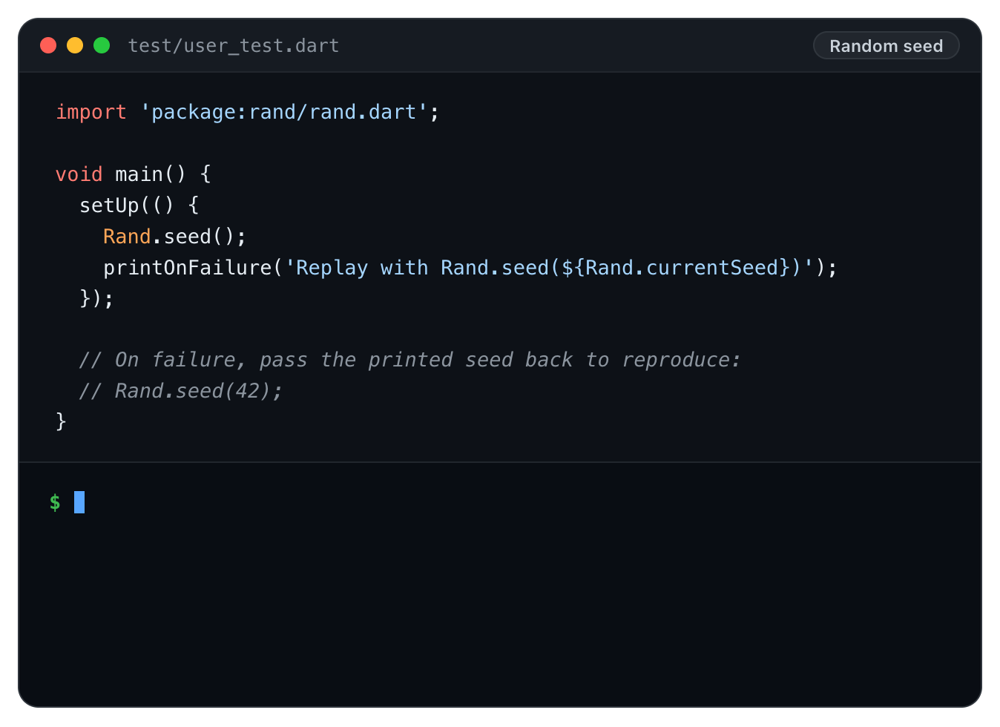

# rand

[](https://pub.dev/packages/rand)
[](https://pub.dev/packages/rand/score)
[](https://github.com/esenmx/rand/actions/workflows/ci.yaml)
[](LICENSE)

`rand` generates realistic random values for Dart — names, emails, dates, IP
addresses, UUIDs, lorem text, CSS colors, weighted picks — one static call each.
Seed it, and every call except the cryptographic ones returns the same values on
the next run. Pure Dart, all six platforms, no Flutter dependency.



## Quick start

If only your tests use `rand`, add it as a dev dependency:

```bash
dart pub add dev:rand
```

App code uses it too (demo data, prototypes)? Run `dart pub add rand` instead.

```dart
import 'dart:convert';

import 'package:rand/rand.dart';
import 'package:test/test.dart';

void main() {
  // Fresh data on every run; a failing test prints the seed that replays it.
  setUp(() {
    Rand.seed();
    printOnFailure('Replay with Rand.seed(${Rand.currentSeed})');
  });

  test('a user survives a JSON round trip', () {
    final user = {'name': Rand.fullName(), 'email': Rand.email()};
    expect(jsonDecode(jsonEncode(user)), user);
  });
}
```

## API at a glance

Every generator is a static member of `Rand`; `RandGen` provides the same
non-cryptographic API over your own `Random` instance.

| Area | API |
| --- | --- |
| [Seeding](doc/seeding.md#seeding-and-reproducibility) | `seed`, `currentSeed`, `withSeed`, `useRng`, `RandGen` |
| [Numbers](doc/generators.md#numbers) | `integer`, `float`, `latitude`, `longitude`, `charCode` |
| [Probability](doc/generators.md#probability) | `boolean`, `nullable` |
| [Text](doc/generators.md#text) | `word`, `words`, `sentence`, `paragraph`, `article` |
| [Identity and geo](doc/generators.md#identity-and-geo) | `firstName`, `lastName`, `fullName`, `alias`, `city`, `geoPoint` |
| [Networking](doc/generators.md#networking) | `email`, `ipv4`, `ipv6`, `mac`, `hex`, `semver`, `digits`, `slug` |
| [IDs](doc/generators.md#ids) | `uuidV4`, `uuidV7`, `ulid` |
| [Time](doc/generators.md#time) | `dateTime`, `duration` |
| [Collections](doc/generators.md#collections) | `element`, `enumValue`, `subset`, `shuffled`, `mapKey`, `mapValue`, `mapEntry` |
| [Weighted sampling](doc/generators.md#weighted-sampling) | `sample` |
| [Colors](doc/generators.md#colors) | `color`, `colorDark`, `colorLight`, `CssColors` |
| [Cryptographic tokens](doc/generators.md#cryptographic-tokens) | `bytes`, `nonce`, `password`, `base64`, `secureCharCode`, `base62Alphabet` (`Rand` only) |

## Guides

- [Seeding and testing](doc/seeding.md) — `seed`, `withSeed`, `RandGen`,
  replaying failed tests, half-open `[min, max)` ranges, and when to use vs
  skip.
- [Generators reference](doc/generators.md) — every generator with examples,
  precision, and platform rules.
- [Pitfalls](doc/pitfalls.md) — exclusive bounds, CSPRNG vs seed, `subset` set
  deduplication, and [`example/recipes.dart`](example/recipes.dart).

## Agent skill

This package ships an agent skill in `skills/rand-test-data/`. Install it into
your project's agent config with:

```sh
dart run skills@ get --package rand --all
```

Add `--agent <name>` (claude, cursor, codex, copilot, …) when no agent config is
detected.

## Contributing

See [CONTRIBUTING.md](CONTRIBUTING.md).

## License

MIT — see [LICENSE](LICENSE).
